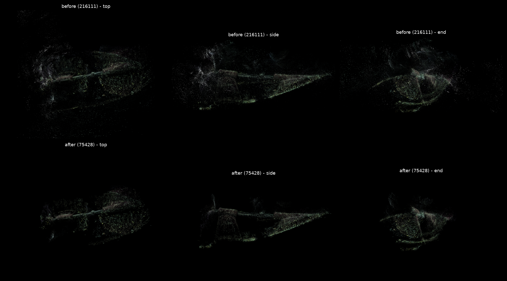

# Automatic cleaning of Gaussian splats

Removes noise (haze, floaters, white glare blobs) from a 3D Gaussian Splatting file, replacing the manual cleanup in SuperSplat. It was built for our ship hull reconstructions but works on any splat scene: thresholds can be given as percentiles of the file itself, and `--stats` shows the value ranges of a new file before you choose them.

**The idea.** In our hull reconstructions the noise is not random: it is made of Gaussians that look different from the hull. Each Gaussian stores its position, opacity, size (3 axes), rotation and colour, so we can find the noise from those values alone, without rendering anything:

- **Haze and fog** are nearly transparent. Water, suspended particles and lighting changes that the model cannot explain end up as many faint Gaussians. In our iteration-7000 test, half of the Gaussians had opacity below 0.06.
- **Blurry blobs** are much larger than the Gaussians on the hull surface.
- **Streaks** are needle-shaped: one axis is much longer than the other two.
- **Floaters** sit in the water, not connected to the hull.
- **White glare** (backscatter or the ROV lights) is very bright and close to white. In our test it is concentrated around the propeller.

The script applies one filter per type and writes a new file, which SuperSplat and any 3DGS viewer can open. The input file is never changed.



```
point_cloud.ply --> 1. opacity filter     (haze)
                --> 2. scale filter       (blurry blobs)
                --> 3. needle filter      (streaks)
                --> 4. brightness filter  (white glare, optional)
                --> 5. your own rules     (--remove / --keep on any property, optional)
                --> 6. main-body filter   (floaters away from the object)
                --> 7. outlier filter     (isolated specks)
                --> cleaned .ply or .splat  (+ optional before/after preview .png)
```

## 1. Install

```bash
pip install -r requirements.txt        # numpy, scipy, matplotlib (matplotlib only for --preview)
```

The `sgo-test` conda environment already has all three:

```bash
conda activate sgo-test
```

## 2. Run

```bash
cd ~/ShipHull/SplatCleaning

# look at the value ranges of a new file first (prints a table, writes nothing)
python clean_splat.py ~/Downloads/iteration_7000/point_cloud.ply --stats

# default cleaning
python clean_splat.py ~/Downloads/iteration_7000/point_cloud.ply cleaned.ply

# same, with a before/after picture
python clean_splat.py ~/Downloads/iteration_7000/point_cloud.ply cleaned.ply --preview cleaned.png

# all options
python clean_splat.py --help
```

### Full command with every option written out

This gives the same result as the default command, but shows every value so you only have to edit numbers. The `--keep` rule lists every property at its full range (`p0:p100` = from the smallest to the largest value in the file), so it keeps everything until you narrow a range, the same way as dragging a range on a SuperSplat histogram.

```bash
python clean_splat.py ~/Downloads/iteration_7000/point_cloud.ply cleaned.ply \
  --min-opacity 0.05 --max-scale-pct 99 --max-aniso 10 --max-lum 0 \
  --keep "x:p0:p100,y:p0:p100,z:p0:p100,opacity:0:1,red:0:1,green:0:1,blue:0:1,hue:0:360,saturation:0:1,value:0:1,lum:0:1,scale_x:p0:p100,scale_y:p0:p100,scale_z:p0:p100,scale_max:p0:p100,scale_min:p0:p100,aniso:p0:p100,volume:p0:p100,surface_area:p0:p100,distance:p0:p100" \
  --body-voxel 0 --body-opacity 0.3 --body-dilate 2 --body-min-frac 0.25 \
  --sor-k 16 --sor-std 2.0 \
  --preview cleaned.png
```

For example, change `distance:p0:p100` to `distance:p0:p98` to drop the 2% of splats farthest from the object, or `opacity:0:1` to `opacity:0.1:1` to drop everything fainter than 0.1. To remove a range instead of keeping one (such as white glare: bright **and** unsaturated), add a `--remove` rule, e.g. `--remove "value:0.85:1,saturation:0:0.15"`.

Then open the result in SuperSplat to check it. The preview `.png` is only a quick check: it draws each Gaussian as a dot (coloured, with its opacity as transparency) from three directions along the object's main axes, not a real splat render.

The script prints how many Gaussians each filter removed, for example on our test file with the defaults:

```
input: 216111 splats
  opacity      -   95498  ( 44.2%)  left 120613
  scale        -    2053  (  0.9%)  left 118560
  needle       -     303  (  0.1%)  left 118257
  body@0.251   -   32214  ( 14.9%)  left 86043
  SOR          -    4370  (  2.0%)  left 81673
wrote 81673 splats to cleaned.ply
```

### File formats

| Input | Output |
|---|---|
| Standard 3DGS `.ply` (INRIA, gsplat, nerfstudio, 2DGS, ...): binary or ascii, any property types, extra properties kept | Same layout, same header, only fewer splats |
| SuperSplat compressed `.ply` | Standard (uncompressed) `.ply` |
| `.splat` | `.ply` or `.splat` |

The output format follows the output file extension: `out.ply` or `out.splat`. `.spz`, `.ksplat` and `.sog` are not supported; export the scene as `.ply` from SuperSplat first.

## 3. Recipes

```bash
IN=~/Downloads/iteration_7000/point_cloud.ply

# only remove what is outside the object, nothing from the object itself
python clean_splat.py $IN cleaned_outside_only.ply \
  --min-opacity 0 --max-scale-pct 100 --max-aniso 0 --body-dilate 4 --body-opacity 0.2 --sor-k 0

# remove haze but keep faint thin parts (our propeller)
python clean_splat.py $IN cleaned_keep_prop.ply \
  --min-opacity 0.04 --max-aniso 100 --body-dilate 4 --body-opacity 0.2

# also remove white glare (bright and unsaturated, so white paint is at risk, coloured parts are not)
python clean_splat.py $IN cleaned.ply --remove "value:0.85:,saturation::0.15"

# remove the largest 0.5% of splats by volume
python clean_splat.py $IN cleaned.ply --remove "volume:p99.5:"

# keep only a box around the object (values from --stats or SuperSplat)
python clean_splat.py $IN cleaned.ply --keep "x:-9:12,y:-6:6,z:-2:8"

# write a .splat for a web viewer
python clean_splat.py $IN cleaned.splat
```

On our test file, how much of the propeller survives (solid propeller splats kept, out of 811):

| Recipe | Splats kept | Propeller kept |
|---|---|---|
| outside only | 166645 | 811 |
| keep propeller | 117749 | 684 |
| default | 81673 | 536 |
| default + `--max-lum 0.85` | 76646 | 438 |

The propeller is faint at iteration 7000, about as transparent as the haze, so stronger haze removal always costs some of it.

## 4. What each filter does, and how to tune it

Filters run in the order below. Each one only looks at the Gaussians the previous filters kept. Every filter can be turned off.

| # | Filter | Removes a Gaussian when | Option (default) | Off |
|---|---|---|---|---|
| 1 | Opacity | opacity < threshold | `--min-opacity 0.05` | `0` |
| 2 | Scale | its longest axis is above this percentile of all longest axes | `--max-scale-pct 99` | `100` |
| 3 | Needle | longest axis / second-longest axis > ratio (flat discs on surfaces are kept) | `--max-aniso 10` | `0` |
| 4 | Brightness | mean colour (0-1) > threshold | `--max-lum 0` | `0` (off by default) |
| 5 | Rules | it matches a `--remove` rule, or it matches no `--keep` rule (see below) | none | leave out |
| 6 | Main body | it is not on or near a large connected solid part (see below) | `--body-voxel 0` (auto), `--body-opacity 0.3`, `--body-dilate 2`, `--body-min-frac 0.25` | `--body-voxel -1` |
| 7 | Outliers (SOR) | its mean distance to its `k` nearest neighbours is more than `std` standard deviations above the average | `--sor-k 16`, `--sor-std 2.0` | `--sor-k 0` |

**How the main-body filter works.** It divides space into small cubes (voxels) and marks the cubes that contain at least one solid Gaussian (opacity ≥ `--body-opacity`). Marked cubes that touch each other form groups. The largest group is the object; any other group with at least `--body-min-frac` of its size (25% by default) is kept too, so an object that falls apart into two halves is not cut in half. The kept groups are grown by `--body-dilate` cubes in every direction, so that faint detail on the surface is kept, and every Gaussian outside the grown region is removed. With `--body-voxel 0` the cube size is 4× the median Gaussian size (about 0.25 in our test). A smaller separate object you want to keep (a target on the seabed) can still be removed: lower `--body-min-frac` or turn this filter off.

### Rules: filter on any property, like SuperSplat's Splat Data panel

A rule is a comma-separated list of conditions `property:low:high`; a Gaussian matches the rule when all conditions hold. A bound can be empty (no limit), a number, or a percentile of the input file such as `p99`. Percentiles make a rule work on scenes of any size and unit.

- `--remove RULE` removes the Gaussians that match it. Repeat it for several rules.
- `--keep RULE` keeps only the Gaussians that match at least one `--keep` rule.

| Property | Meaning | Range |
|---|---|---|
| `x`, `y`, `z` | position | scene units |
| `opacity` | opacity | 0-1 |
| `red`, `green`, `blue` | base colour | 0-1 |
| `hue` | colour hue (0 red, 120 green, 240 blue) | 0-360 |
| `saturation` | colour saturation (0 = grey/white) | 0-1 |
| `value` | brightness, max of red/green/blue | 0-1 |
| `lum` | mean of red/green/blue (what `--max-lum` uses) | 0-1 |
| `scale_x`, `scale_y`, `scale_z` | size along each axis | scene units |
| `scale_max`, `scale_min` | longest / shortest axis | scene units |
| `aniso` | longest / second-longest axis (what `--max-aniso` uses) | ≥ 1 |
| `volume`, `surface_area` | ellipsoid volume and surface area | scene units |
| `distance` | distance from the centre of the solid Gaussians | scene units |

Run `--stats` to see the percentiles of each property for your file. SuperSplat's Camera Depth and Quaternion values have no equivalent here.

**Tuning tips**

- **Still too hazy?** Raise `--min-opacity` to 0.1. Lower it to 0.02 if thin detail disappears.
- **Parts of the object missing?** Raise `--body-dilate` to 3 or 4, or lower `--body-opacity` to 0.2. If one part is detached from the rest, lower `--body-min-frac` or turn the main-body filter off.
- **Glare still there?** Use `--remove "value:0.85:,saturation::0.15"`, or `--max-lum 0.85` for a stronger cut. Both remove white paint or markings too.
- **Specks left around the object?** Lower `--sor-std` to 1.5.

Compare settings with `--preview`, then open the result in SuperSplat.

## 5. Limitations

- `.spz`, `.ksplat` and `.sog` files are not supported.
- The SuperSplat compressed `.ply` reader was written from the format description and tested on a synthetic file, not on a file exported by SuperSplat. Check the first result in SuperSplat.
- A `.splat` stores only colour, no view-dependent colour (spherical harmonics), so writing `.splat` loses those.
- The default thresholds are rules of thumb, tuned on one reconstruction (iteration 7000). Run `--stats` and check each new dataset in SuperSplat.
- It only removes Gaussians; it does not fix holes or wrong colours.

## 6. Getting less noise in the first place

Cleaning afterwards treats the symptom. These change the training itself:

1. **Train longer** (30k iterations). The standard 3DGS training resets opacity periodically and removes Gaussians that stay transparent, so much of the haze seen at iteration 7000 disappears.
2. **Underwater methods** such as WaterSplatting and SeaSplat model the water (attenuation and backscatter) separately, so the haze is not stored as Gaussians. This probably helps our data the most.
3. **Masks.** Mask the hull in each image (for example with SAM) and train with the masks, so no Gaussians are created in the water.
4. **Stronger pruning during training**, as in AbsGS or Mini-Splatting.
